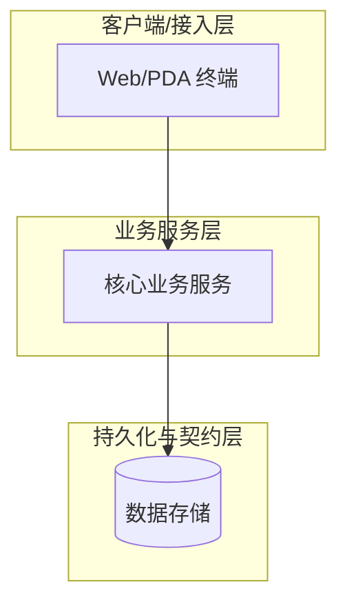
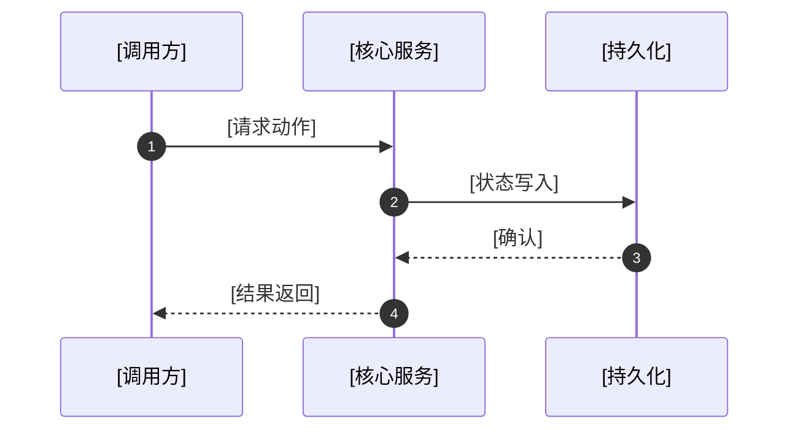

# [系统/子系统/方案名称] 架构设计说明书

## 1. 设计背景与业务诉求 (Background & Motivation)
- **业务痛点与现状**：[传统模式存在什么弊端，为什么需要本架构设计]
- **设计目标 (In-Scope)**：[明确本设计必须解决的核心问题与交付物]
- **边界与非目标 (Out-of-Scope)**：[明确本方案不涉及的范畴]

## 2. 总体架构与系统上下文 (System Architecture & Context)
- **系统拓扑图**（使用 Mermaid 语法展示组件边界与外部系统交互）：

- **核心组件职责矩阵**：
| 组件 / 子系统 | 对应驾驶舱链接 | 物理形态 | 核心职责 |
|---|---|---|---|
| `xxx-service` | [[doc/modules/mod-xxx.md]] | 容器/微服务 | [说明该组件的核心职责边界] |

## 3. 详细设计与机制分析 (Detailed Design)
- **核心数据流与交互时序**：

- **关键机制剖析**：[深入阐述算法、状态机、缓存策略或数据流转闭环]

## 4. 关键设计决策记录 (Architecture Decision Records - ADR)
> 记录关键架构权衡，解释“为什么选方案 A 而不是方案 B”：
- **ADR-01：[关键设计决策名称]**
  - **背景与备选项**：方案 A vs 方案 B；
  - **采纳方案与理由**：[详细说明在性能、复杂度、一致性上的权衡结论]。

## 5. 非功能性考量与容错保障 (Non-Functional Requirements)
- **高可用与容错**：[超时重试、服务降级与熔断对策]
- **数据一致性与安全防呆**：[事务控制、防篡改门禁、鉴权机制]
- **监控与可观测性**：[关键监控指标、告警阈值与日志追踪链路]
