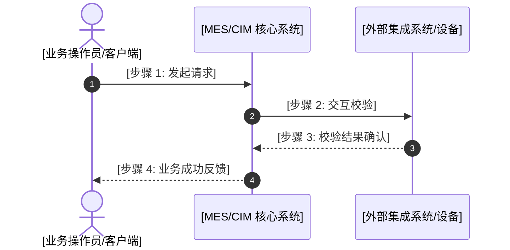

# Functional Requirement Document (FRD) Template

> 知识抽取（Stage 2）抽取 `doc/business/` 下的 `frd`（功能需求文档——端到端业务用例与操作流程，旧称 workflow/scenario）节点时，节点的 `content` 应当遵循此人读骨架结构。
> 编译落盘路径：`data/wiki/<project>/doc/business/frd-<domain>-<name>.md`

---

# [业务流程/场景名称]

## 1. 业务场景概述 (Overview)
- **业务目标与价值**：[一句话说明该流程解决什么业务痛点，达到什么目标]
- **触发时机与主体**：[由什么事件/角色触发，如操作员手动发起、EAP 自动化事件上报]
- **前置依赖条件**：[业务实体必须满足的前提，如工单处于 Released 状态、设备处于 IDLE 状态]
- **预期业务成果**：[流程执行完毕后产生的核心成果或状态变更]

## 2. 端到端泳道时序视图 (Workflow Diagram)


## 3. 分阶段详细实操步骤 (Step-by-Step Operations)
> 严禁只提供空泛表格！每一阶段必须包含真实的操作指引、执行指令或界面指引。

### 阶段一：[阶段名称，如：准备与前置校验]
1. **操作目的与动作**：[说明本阶段的具体业务行为]
2. **执行指令 / 界面指引**：
   ```bash
   # [执行命令或配置文件修改说明]
   ```
3. **输入参数 / 字段说明表**：
   | 字段/参数名 | 界面标签 | 是否必填 | 格式/类型 | 业务含义与取值示例 |
   |---|---|---|---|---|
   | `xxx` | `xxx` | 是 | String | ... |
4. **预期执行结果与验证**：
   - [界面反馈提示或终端返回日志示例]

### 阶段二：[阶段名称，如：核心处理与状态流转]
（同上格式，详述动作、参数与预期反馈）

## 4. 步骤汇总对照表 (Steps Summary Table)
> 保留供自动化工具与图谱分析索引的快速对照表：

## Steps
| Step | Actor | Action | Target / Transaction | Hint |
|---|---|---|---|---|
| 1 | [操作角色] | [动作名称] | [[code/domain/bo-xxx.md]] | [操作提示与契约链接] |
| 2 | [系统模块] | [核心处理] | [[code/apis/api-xxx.md]] | [API 事务码或端点] |

## 5. 分支决策与故障补偿 (What-Next & Rollback)
> 覆盖业务异常与重试逻辑，确保流程具备闭环韧性：

## What-Next Branches
- **[分支场景 1：校验失败]**：[判定条件 $\rightarrow$ 补偿处置动作 $\rightarrow$ 责任角色]
- **[分支场景 2：外部接口超时]**：[判定条件 $\rightarrow$ 重试策略或降级流程]

## 6. 常见异常排查指引 (Troubleshooting)
| 异常报错信息 / 现象 | 产生根因 | 排查与处置步骤 |
|---|---|---|
| `[错误示例]` | [原因分析] | [明确的排查处置命令或操作] |
