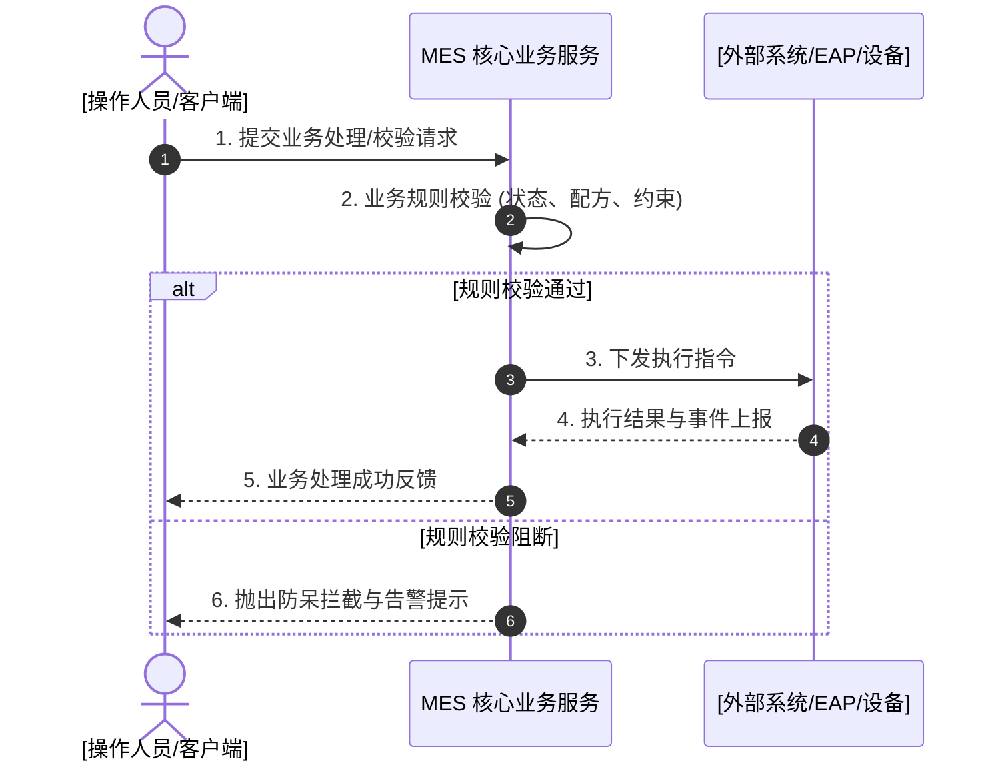

# [业务工序/功能模块名称] 功能需求规格书 (Functional Requirement Definition - FRD)

> **使用指引**:
> 1. 本文档为半导体 CIM/MES 领域标准 FRD（业务功能需求规格书）的**标准骨架模板**；
> 2. 面向业务分析师 (BA)、工艺工程师 (PE) 与软件架构师，定义完整的模块定位、特性矩阵、多场景交互时序、数据项与控制规则；
> 3. 具体实施编写时，请参考完整工程样例：[examples/functional-requirement-example.md](../examples/functional-requirement-example.md)。

---

## 1. 概述 (Overview)

### 1.1 业务背景与目标 (Objective)
- **需求标识**: FRD-[DOMAIN]-[SEQ]（如 `FRD-WIP-001`）
- **业务背景与痛点**: [说明提出该业务需求的制造工艺或工程背景，如传统作业模式下的弊端、缺乏精细控制可能导致的工艺漂移或物料损耗等]
- **业务目标与收益**: [明确该功能带来的量化效益，如提升设备稼动率、杜绝批次报废、实现全自动化事件闭环跟踪等]

### 1.2 功能范围与特性矩阵 (Function Scope & Feature Matrix)
- **覆盖功能域**: [如：Modeling (资源建模) / EQP Mgmt (设备管理) / Recipe Resolution (配方解析) / WIP Mgmt (批次在制品管理) / Process Control (工艺卡控) / Q-Time Control (时间窗口控制) 等]
- **In-Scope (包含)**: [明确界定本次规格书覆盖的全部业务活动、功能特性与用例集合]
- **Out-of-Scope (排除)**: [明确界定本次不涉及或交由外部独立系统/底层驱动处理的边界]

#### 功能特性与场景分解矩阵 (Feature & Scenario Breakdown)
| 特性编号 | 所属功能域 | 功能特性名称 (Feature Name) | 包含的业务场景 (Scenarios) | 业务与控制概述 |
|---|---|---|---|---|
| F-01 | [功能域代码] | [功能特性一名称] | Scenario 1: [业务场景 1 名称] Scenario 2: [业务场景 2 名称] | [概述该特性解决的核心业务问题与控制范围] |
| F-02 | [功能域代码] | [功能特性二名称] | Scenario 3: [业务场景 3 名称] | [概述该特性解决的核心业务问题与控制范围] |

### 1.3 系统集成范围与边界 (System Scope)
明确各交互系统的协同边界与职责分工：
| 系统标识 | 系统全称 | 集成边界与核心交互职责 |
|---|---|---|
| **MES** | 制造执行系统 (Manufacturing Execution System) | 业务逻辑仲裁、状态机维护、规则校验、配方解析与派工指令下发 |
| **EAP** | 设备自动化接入平台 (Equipment Automation Program) | 设备底层报文交互、事件实时上报 (Event Report)、载具搬运与端口状态同步 |
| **[系统缩写]** | [系统全称] | [该系统与本模块的交互边界与职责分工说明] |

### 1.4 参考与关联文档 (Reference Documents)
- `[[doc/designs/des-xxx.md]]` - [关联的概要架构或系统设计说明书]
- `[[doc/business/frd-xxx.md]]` - [关联的前置或同源业务功能需求规格书]
- `[[code/rules/br-xxx.md]]` - [关联的核心功能契约校验规则]

### 1.5 用户需求跟踪清单 (User Requirement List)
| 需求来源 | 需求点编号 | 需求描述 | 对应场景 (Scenario) | 优先级 | 备注 |
|---|---|---|---|---|---|
| [业务部门/角色] | REQ-[MODULE]-001 | [需求简述] | Scenario 1: [对应场景名称] | High / Medium / Low | [说明约束或要求] |

### 1.6 术语与业务缩略词 (Terminology)
| 编号 | To-Be 术语 | 中文命名 | 对照与 AMAT 300Works 用法 | 业务释义与工程定义 |
|---|---|---|---|---|
| 1 | [英文术语] | [中文标准命名] | [300Works 对应术语] | [业务释义与制造工程定义说明] |

### 1.7 方案总体概述 (Solution Overview)
[简述技术实现与业务控制的核心思想，如：多层级资源独立状态机建模、动态计数核算机制、双平面规则解耦等。]

---

## 2. 业务功能与需求场景规格 (Functional Requirements & Scenarios)

> 一个完整的业务模块 FRD 涵盖多个协同的功能特性（Feature 1..N）与细分业务场景（Scenario 1..N）。按功能特性逐一展开其交互契约与规则逻辑：

### 2.1 [功能特性 1 名称，如：批次在制品流转控制]

#### 2.1.1 业务场景描述 (Business Scenario)
- **场景标识**: Scenario 1: [场景名称]
- **场景定位与触发源**: [说明具体场景在制造生命周期中的位置及触发原因]
- **前置条件 (Pre-conditions)**: [业务实体与机台必须满足的前提状态]
- **触发条件 (Trigger)**: [业务事件源，如物料搬运到位 CarrierArrived 事件、作业员界面发起等]
- **后置条件 (Post-conditions)**: [流程执行完毕后系统的最终状态，如产生审计追溯、状态机变迁等]

#### 2.1.2 流程时序与交互泳道 (Workflow & Sequence)

#### 2.1.3 流程执行步骤汇总表 (Steps)
| Step | Actor | Action | Target / Transaction | Hint |
|---|---|---|---|---|
| 1 | [操作角色/系统] | [发起的业务动作] | [[code/domain/bo-xxx.md]] | [操作提示与实体契约链接] |
| 2 | MES Core | [执行业务卡控与规则校验] | [[code/rules/br-xxx.md]] | [关联功能契约校验卡片] |
| 3 | [外部系统/执行者] | [执行具体动作与事件反馈] | [[code/apis/api-xxx.md]] | [API 事务码或交互端点] |

#### 2.1.4 分支流程与异常决策表 (What-Next Branches)
- **[分支 A：前置校验未通过/超规卡控]**: [判定条件 → 阻断流程并弹出告警 → 必须先执行补偿或前置准备流程]；
- **[分支 B：多规则同时触发冲突]**: [判定条件 → 按照优先级策略裁决或执行组合控制]；
- **[分支 C：执行异常/超时]**: [判定条件 → 自动触发异常流程，工单置为 HOLD 等待人工介入]。

#### 2.1.5 界面与数据项定义 (Data Items & UI Specification)
| 数据项名称 (Data Item) | 字段标识 (*必填) | 数据类型 / 长度 | 业务含义与约束规则 | 来源 / 提供方 |
|---|---|---|---|---|
| `[field_name]` | [字段中文名] * | String / Integer / Enum | [字段业务含义、枚举取值范围与约束说明] | [界面录入 / 系统传入] |

#### 2.1.6 业务规则与卡控逻辑 (Business Rules & Validation Logic)
1. **[BR-01 校验时机与计算口径]**: [明确在特定时机触发的计算口径与算法规则]；
2. **[BR-02 前置防呆与卡控规则]**: [明确触发阈值后的硬性拦截策略]；
3. **[BR-03 资源与优先级解析规则]**: [明确多条件、多资源的仲裁解析算法]。

#### 2.1.7 设备与资源状态变迁矩阵 (Equipment State Transition Matrix)
| 业务事件 / 动作 (Event) | 主机台状态 (EQP State) | 腔体状态 (Chamber State) | 内部结构状态 (Header State) | 联动规则与副作用说明 |
|---|---|---|---|---|
| [事件名称 1] | IDLE | IDLE | IDLE | [状态说明] |
| [事件名称 2] | IDLE $\rightarrow$ RUN | IDLE $\rightarrow$ RUN | IDLE | [状态联动与变迁说明] |

---

### 2.2 [功能特性 2 名称 (按需展开)]
> （按照 2.1 相同的标准规范展开其所包含的细分业务场景）

---

## 3. 非功能性需求与系统约束 (Non-Functional Requirements)
- **性能与响应时效 (Performance & SLA)**: [核心交易与事件上报响应耗时要求，如 95% 场景下 $\le 300\text{ms}$]；
- **并发与互斥控制**: [并发操作锁与幂等性保障要求]；
- **全链路可追溯性**: [事件审计、参数历史追溯与时间戳记录要求]。
