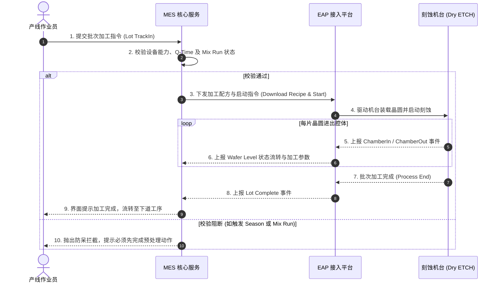

# 12寸晶圆制造 Dry ETCH (干法刻蚀工序) 功能需求规格书 (Functional Requirement Definition - FRD 样例)

> **文档说明**: 本文档作为半导体 CIM/MES 领域标准 FRD（功能需求规格书）的**参考样例**，展示如何依据 `functional-requirement-template.md` 规范编写复杂多场景、跨系统协同的工程级业务功能需求。
> **使用说明**：本示例仅展示文档结构；业务术语与规则必须以绑定项目的有效材料为准。

---

## 1. 概述 (Overview)

### 1.1 业务背景与目标 (Objective)
- **需求标识**: FRD-ETCH-001
- **业务背景与痛点**: 干法刻蚀（Dry ETCH）机台多为包含 LoadPort、Robot、Transfer Chamber 及多个 Process Chamber 的多腔体复杂设备。实际生产中，晶圆在各腔体内经历高温等离子体微观物理/化学反应，容易产生腔体残留反应物附着或工艺漂移。传统人工或粗粒度 MES 管理难以对 Wafer 级流转轨迹、腔体季化暖机（Seasoning）、交替互跑（Mix Run）中和及先行批（Pi-Run）领跑进行微观联动卡控，易造成批量晶圆报废。
- **业务目标与收益**:
  - 实现设备/Chamber/Header 多层级加工资源的精确建模与动态状态联动；
  - 建立全自动化非生产控片（Dummy Wafer）全生命周期闭环管理（装填、计数、自动退出与机械臂置换）；
  - 建立工艺中和（Mix Run）、季化暖机（Seasoning）与先行批（Pi-Run）的自动化卡控仲裁机制，保障工艺稳定性，提升设备稼动率。

### 1.2 功能范围与特性矩阵 (Function Scope & Feature Matrix)
- **覆盖功能域**: Modeling (资源建模) / WIP Mgmt (批次在制品管理) / NPW Mgmt (非生产控片管理) / Process Control (工艺卡控) / Quality Control (质量防呆) / Q-Time Control (时间窗口控制)。
- **In-Scope (包含)**: 刻蚀机台物理资源建模、批次与晶圆级事件流转追踪、腔体状态联动变迁、Dummy 控片进出机与置换、季化暖机计划管控、交替互跑配方中和、先行批领跑测试及站间/晶圆级 Q-Time 校验防呆。
- **Out-of-Scope (排除)**: 机台底层 PLC 驱动控制、实时等离子体射频物理参数闭环采集（交由 EAP 与 FDC 系统处理）。

#### 功能特性与场景分解矩阵 (Feature & Scenario Breakdown)
| 特性编号 | 所属功能域 | 功能特性名称 (Feature Name) | 包含的业务场景 (Scenarios) | 业务与控制概述 |
|---|---|---|---|---|
| F-01 | Modeling | 设备与加工资源建模 | Scenario 1: 设备/Chamber/Header多层级建模 | 支持机台物理结构与串并联加工资源定义 |
| F-02 | WIP Mgmt | 批次在制品流转控制 | Scenario 2: 批次事件流转追踪 (Lot Tracking) Scenario 3: 多层级状态联动变迁 Scenario 4: 配方解析与组合决策 (Recipe Resolution) | 细粒度 Wafer 级事件上报、机台/腔体状态联动与最优 PPID 解析 |
| F-03 | NPW Mgmt | 非生产晶圆全生命周期管理 | Scenario 5: 准备 Dummy Wafer Scenario 6: 自动退出超限 Dummy Scenario 7: 手动退出 Dummy Scenario 8: 机械臂 SWAP Dummy 晶圆置换 | 腔体控片装填、晶圆使用计数卡控、自动/手动及双机械臂置换 |
| F-04 | Process Control | 季化暖机与交替互跑控制 | Scenario 9: 季化暖机计划管控 (Season Control) Scenario 10: 交替互跑工艺中和 (Mix Run Control) Scenario 11: 同时触发 Season 与 Mix Run 仲裁 | 长时间空闲/换配方暖机以稳定腔体、残留物中和及多规则冲突裁决 |
| F-05 | EQP Monitor | 设备加工能力定期监控 | Scenario 12: 监控计划与 SPC 数据比对 | 定时/定量使用测试片量测膜厚颗粒，确认机台加工能力 |
| F-06 | Quality Control | 先行批领跑验证控制 | Scenario 13: 先行批领跑测试 (Pi-Run Control) Scenario 14: 同时触发 Mix Run 与 Pi-Run | 工艺条件变动时分出小批试跑，卡控大批量生产批次前置条件 |
| F-07 | Process Control | 跨站与晶圆级时间窗口控制 | Scenario 15: 跨工步与晶圆级 Q-Time Control | 宏观站间停留时限监控与腔体间微观 Wafer 级时差卡控防呆 |

### 1.3 系统集成范围与边界 (System Scope)
| 系统标识 | 系统全称 | 集成边界与核心交互职责 |
|---|---|---|
| **MES** | 制造执行系统 (Manufacturing Execution System) | 业务逻辑仲裁、状态机维护、规则校验、配方解析与派工指令下发 |
| **EAP** | 设备自动化接入平台 (Equipment Automation Program) | 设备底层报文交互、事件实时上报 (Event Report)、载具搬运与端口状态同步 |
| **MCS/AMHS** | 物料搬送控制系统 (Material Control System) | 晶圆载具 (FOUP/Carrier) 跨区调度与自动化搬送 |
| **RTD/FAM** | 实时派工与先进物料管理 | 基于机台状态与工艺能力进行最优派工与在制品预约 |
| **SPC/EDC** | 统计过程控制 / 工程数据采集 | 晶圆前后量测数据比对、判异规则监控与 OCAP 触发 |

### 1.4 参考与关联文档 (Reference Documents)
- `[[doc/designs/des-arch-dual-plane.md]]` - 双平面架构设计说明书
- `[[code/rules/br-pipe-draft-gate.md]]` - 业务防呆门禁校验规则
- `[[code/apis/api-admin-sync-status.md]]` - 状态回写与审计同步接口

### 1.5 用户需求跟踪清单 (User Requirement List)
| 需求来源 | 需求点编号 | 需求描述 | 对应场景 (Scenario) | 优先级 | 备注 |
|---|---|---|---|---|---|
| PE 工艺部 | REQ-ETCH-001 | 腔体空闲超 4 小时或换 Recipe 必须自动触发暖机 | Scenario 9: 季化暖机计划管控 | High | 工艺稳定性硬性要求 |
| PE 工艺部 | REQ-ETCH-002 | 加工特定 Recipe 累计超 50 片必须插入 Clean Recipe | Scenario 10: 交替互跑工艺中和 | High | 消除反应残留物 |
| 生产制造部 | REQ-ETCH-003 | 支持机械臂双指 SWAP 一次性完成 Dummy 进出置换 | Scenario 8: 机械臂 SWAP 置换 | Medium | 缩减非生产等待时间 |

### 1.6 术语与业务缩略词 (Terminology)
| 编号 | To-Be 术语 | 中文命名 | 项目参考术语（可选） | 业务释义与工程定义 |
|---|---|---|---|---|
| 1 | Pilot Lot | 领跑生产批 | Pilot Lot | 从母批中分出用于工艺先行验证的生产晶圆批次 |
| 2 | Pi-Run | 领跑加工 | Pilot Run / Pi-Run | 评估机台工艺稳定性与大批量加工可行性的先行验证流程 |
| 3 | Dummy Wafer | 挡控片/虚拟晶圆 | Dummy Wafer | 用于机台腔体预热、清洗 (Clean) 或季化 (Season) 的非生产晶圆 |
| 4 | Mix Run | 交替互跑控制 | Mix Run / Alternate Run | 在连续加工同一 Recipe 产生附着物时，强制穿插指定 Recipe 进行中和改善 |
| 5 | Seasoning | 季化暖机 | Chamber Seasoning | 腔体清洗或长时间空闲后，通过 Dummy 预热使其达到热平衡状态 |

### 1.7 方案总体概述 (Solution Overview)
本方案基于“多层级资源独立状态机”、“Forecast 动态晶圆计数预测”与“双平面规则解耦”原则，将刻蚀工序细化为 7 大功能特性与 15 个具体业务场景，实现从机台建模到生产全生命周期的数字化与自动化闭环。

---

## 2. 业务功能与需求场景规格 (Functional Requirements & Scenarios)

### 2.1 功能特性 1：批次在制品流转控制 (WIP Lot Tracking)

#### 2.1.1 业务场景描述 (Business Scenario)
- **场景标识**: Scenario 2: 批次事件流转追踪 (Lot Tracking)
- **场景定位与触发源**: 批次进入刻蚀机台加工，MES 必须依据 EAP 实时上报的晶圆进出腔体事件，更新晶圆与机台/腔体状态。
- **前置条件 (Pre-conditions)**: 批次在当前站点已完成 TrackIn，设备状态为 IDLE，配方解析 (PPID) 已完成校验。
- **触发条件 (Trigger)**: EAP 上报 CarrierArrived、PortClamp、WaferMoveIn 等事件。
- **后置条件 (Post-conditions)**: 批次所有 Wafer 完成刻蚀，生成生产历史流水，更新机台累计加工片数。

#### 2.1.2 流程时序与交互泳道 (Workflow & Sequence)

#### 2.1.3 流程执行步骤汇总表 (Steps)
| Step | Actor | Action | Target / Transaction | Hint |
|---|---|---|---|---|
| 1 | Operator | 发起 TrackIn 批次进站 | [[code/domain/bo-wiki-doc.md]] | 扫描批次号与机台号发起加工 |
| 2 | MES Core | 校验工艺规则与前置条件 | [[code/rules/br-pipe-draft-gate.md]] | 检查 Chamber 状态、Q-Time 限制与暖机要求 |
| 3 | MES Core | 执行配方最优解析 (Recipe Resolution) | [[code/domain/bo-wiki-node.md]] | 依据产品线与腔体配置选择最优 PPID |
| 4 | EAP | 下发控制参数并启动机台 | [[code/apis/api-admin-pull-config.md]] | 下发 Recipe 与 Chamber 跑货模式 (Serial/Parallel) |
| 5 | EAP / Tool | 逐片上报晶圆流转事件 | [[code/apis/api-admin-wiki-nodes.md]] | Wafer 进入 Chamber、加工结束、传出 Chamber |
| 6 | MES Core | 更新状态机并记录工时流水 | [[code/apis/api-admin-sync-status.md]] | 更新 Lot 状态为 TRACKOUT_WAIT，累计设备加工计数 |

#### 2.1.4 分支流程与异常决策表 (What-Next Branches)
- **[分支 A：触发季化暖机卡控 (Seasoning Required)]**: 腔体空闲时长超标 $\rightarrow$ 阻断正常批次生产 $\rightarrow$ 强制要求先调度并加工 Dummy 批次；
- **[分支 B：触发交替互跑中和 (Mix Run Required)]**: 连续跑同种配方片数达到阈值 $\rightarrow$ 阻断当前配方 $\rightarrow$ 强制要求穿插中和配方或清洗工步；
- **[分支 C：工艺量测超规 (SPC Alarm / OCAP)]**: 出现异常 $\rightarrow$ 自动触发 OCAP 流程，工单置为 HOLD_LOT $\rightarrow$ 工艺工程师介入复核。

#### 2.1.5 界面与数据项定义 (Data Items & UI Specification)
| 数据项名称 (Data Item) | 字段标识 (*必填) | 数据类型 / 长度 | 业务含义与约束规则 | 来源 / 提供方 |
|---|---|---|---|---|
| `equipment_id` | 设备编号 * | String/16 | 刻蚀机台物理唯一标识 | 扫码录入 / 系统传入 |
| `chamber_id` | 腔体编号 * | String/8 | 机台子腔体标识 (如 PM1, PM2, PM3) | 系统建模维护 |
| `lot_id` | 批次号 * | String/18 | 晶圆在制品加工批次标识 | MES 批次管理 |
| `ppid` | 配方编号 * | String/32 | 机台刻蚀参数配方代码 | MES 配方管理 |
| `run_mode` | 加工模式 * | Enum (Serial, Parallel) | 串联依次加工或多腔体并联加工 | 工艺设定 |

#### 2.1.6 业务规则与卡控逻辑 (Business Rules & Validation Logic)
1. **[BR-ETCH-001 设备状态机联动]**: 机台处于 RUNNING 状态时，至少有一个关联 Chamber 处于 RUNNING；所有 Chamber 处于 IDLE 时，机台主体状态自动回到 IDLE；
2. **[BR-ETCH-002 晶圆级 Q-Time 防呆]**: 监控晶圆在 Transfer Chamber 与 Process Chamber 之间的停留时限，超时立即置机台为 ALARM；
3. **[BR-ETCH-003 配方与腔体一致性校验]**: 下发 PPID 前，校验该腔体当前硬件配置与物理气体管路是否与配方要求相匹配。

#### 2.1.7 设备与资源状态变迁矩阵 (Equipment State Transition Matrix)
| 业务事件 / 动作 (Event) | 主机台状态 (EQP State) | 腔体状态 (Chamber State) | 内部结构状态 (Header State) | 联动规则与副作用说明 |
|---|---|---|---|---|
| TrackIn / Setup | IDLE | IDLE | IDLE | 基础状态确认，默认不联动 |
| Move In | IDLE $\rightarrow$ RUN | IDLE | IDLE | 主机台转为运行态 |
| Chamber Process Start | RUN | IDLE $\rightarrow$ RUN | IDLE | 对应加工腔体激活为 RUN |
| Header Process Start | RUN | RUN | IDLE $\rightarrow$ RUN | 腔体内对应 Header 激活 |
| Chamber/Header Process End | RUN | RUN $\rightarrow$ IDLE | RUN $\rightarrow$ IDLE | 腔体加工完成恢复就绪 |
| Move Out / TrackOut | RUN $\rightarrow$ IDLE | IDLE | IDLE | 主机台完成当前批次，恢复 IDLE |

---

### 2.2 功能特性 2：非生产晶圆全生命周期管理 (NPW Dummy Wafer Control)

#### 2.2.1 业务场景描述
涵盖 Scenario 5（准备 Dummy）、Scenario 6（自动退出超限 Dummy）、Scenario 7（手动退出 Dummy）与 Scenario 8（机械臂 SWAP 置换）。
- 当腔体需要暖机或清洗时，系统自动调度装载专用 Dummy Wafer；
- 记录 Dummy Wafer 累计使用次数，达到上限阈值时触发自动退片机制，并提示物料管理员补入新 Dummy。

---

### 2.3 功能特性 3：季化暖机与交替互跑控制 (Season & Mix Run Control)

#### 2.3.1 业务场景描述
涵盖 Scenario 9（季化暖机管控）、Scenario 10（交替互跑工艺中和）与 Scenario 11（多规则仲裁）。
- **季化暖机**: 机台空闲超过 240 分钟后，强制锁定生产计划，直到运行指定时长或片数的 Seasoning Recipe；
- **交替互跑**: 当 A 类产品加工满 50 片后，系统自动仲裁将后续机台调度锁定为 B 类中和配方，中和完成后方可解锁 A 类配方排产。

---

## 3. 非功能性需求与系统约束 (Non-Functional Requirements)
- **性能时效 (Performance & SLA)**: 刻蚀进出站与晶圆级事件上报响应耗时 $\le 200\text{ms}$；
- **并发互斥控制**: 针对同一腔体状态变迁保证原子锁，杜绝多线程竞争导致状态脱节；
- **高可用与容错**: EAP 断网时具备本地缓存补报机制，通信恢复后按时间戳有序重放事件。
