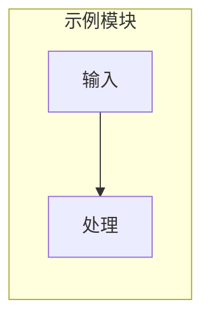

# 图表转换与 Mermaid 渲染

## 选型与呈现

CIM Wiki 前端接入 Mermaid 后，使用标准 fenced code block，在围栏语言处填写 `mermaid`。先确认目标环境已具备渲染支持；本地代码已修改不代表运行中服务已升级。不插入 Vue 组件、原始 SVG/HTML、外部脚本或 CDN 地址来替代 Markdown 图表。

| 原图用途 | 优先类型 |
| --- | --- |
| 模块图、分层图、系统组成与依赖 | `flowchart` + `subgraph` |
| 操作流程、条件分支 | `flowchart` |
| 系统调用时序 | `sequenceDiagram` |
| 状态转换 | `stateDiagram-v2` |
| 实体关系 | `erDiagram` |
| 无法可靠重建的复杂布局、截图或特殊符号 | 保留服务端可访问且登记的PNG等栅格原图或原页面渲染图 |

示例只说明 Markdown 写法，不作为实际系统关系的依据：

````markdown

````

## 从原图到候选文档

1. 逐页识别图表，包含PPT中的形状、组合、连接线和文字；解析器返回的图片数量不代表原图数量。保留原件和图表所在页或章节定位。
2. 核对节点名称、分组、层级、连接端点、箭头方向、条件标签和图例。只有原图明确表达的关系才可转换，不从位置相邻或文字顺序猜测调用链。
3. 将语义图放在对应正文章节。表格和文字用于补充说明，不能代替原图的分组和连接关系。来源、重建差异及不确定项集中在参考文档和独立检查报告，不写成业务正文评论。
4. Mermaid不能完整表达或关系无法确认时，保留可读取的栅格原图；所需渲染服务不可用时停止该部分并记录缺失，不在Agent端安装解析引擎降级。未恢复关键图形语义时，转换状态为部分完成，不声称全文转换完成。

## 验证与交付

- 语法检查：确认生成的源码能被目标环境使用的Mermaid版本解析；不依赖未经验证的新语法或自定义初始化指令。
- 页面检查：在实际Wiki前端或隔离预览中确认图形可见、中文可读、分组和箭头正确；长图检查是否可滚动或缩放阅读。渲染失败时修复，不能把源码回退显示视为图形渲染成功。
- 内容检查：将渲染结果与原图对照，确认无节点或关键关系缺失。实际部署或发布有独立授权要求，不能为验证图表自动发布业务内容。
- 在独立报告中列明原图数量、已重建／保留数量、语法和页面验证结果、剩余差异。未执行浏览器核对时如实标记未验证；`check-document`通过、原图附件存在或Mermaid语法正确均不能单独证明图表转换完整。

前端为Mermaid使用严格安全模式并在失败时保留源码。Skill不得要求启用宽松安全模式、HTML标签或点击脚本来使图形显示。
