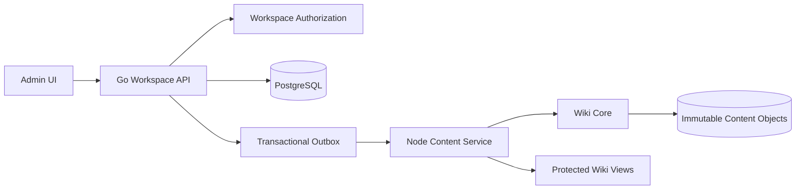
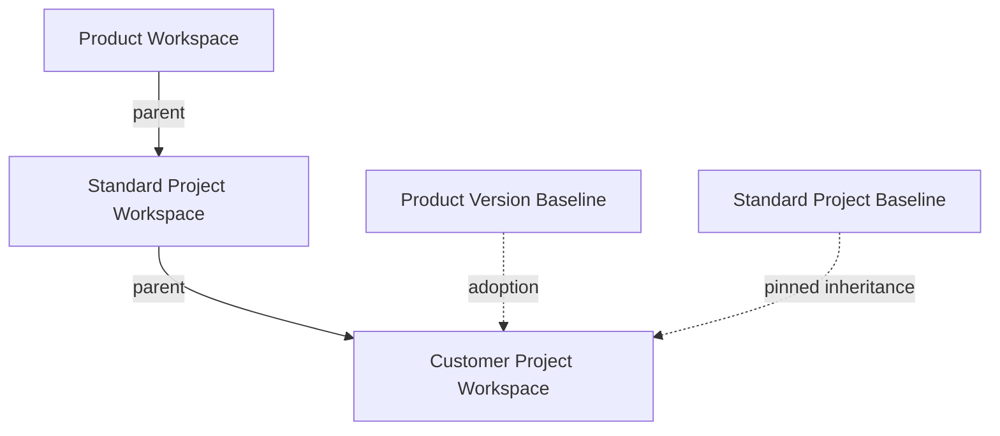

# Feature：Workspace 产品、项目与文档继承

## Document Information

- Document ID：feature-workspace-management
- Created Date：2026-11-07
- Status：后续规划，本期不实施；当前范围见 [简化方案](feature-product-directory-pipeline.md)
- 需求：[urd-workspace-management](urd-workspace-management.md)
- 本文为设计，不代表下述功能已经实现。

## 1. Overview

### Purpose

使用 Workspace 统一产品与项目的身份、文档、版本、基线和授权边界；提供产品管理，并支持产品到项目、项目到项目的固定基线继承。

### Business Value

同一套底层能力服务产品与客户项目；子级复用父级知识并维护差异，上游发布不会悄然改变已交付项目。产品版本、文档修订、交付基线分别追踪。

### Scope

覆盖产品及项目 Workspace 管理、版本、标准目录初始化、页面修订、基线浏览与比较、单父级继承和升级、采用关系、Token 隔离及兼容迁移。首期不做多父级合并、实时继承、完整多用户账户系统、通用任务跟踪、历史草稿一键恢复、自动部署。

命名建议：底层 `Workspace`，枚举 `product | project`。界面仍为“产品管理”“项目管理”；公共能力使用“工作空间设置”。`Namespace` 可用于路径概念，不替代领域实体。

## 2. Architecture

### 2.1 现状与职责

| 组件 | 已核对现状 | 本次职责 |
|---|---|---|
| Go Admin | `internal/handler/admin.go`、`internal/store/postgres.go`，项目 CRUD 与 Token | Workspace 元数据、版本、授权、关系、数据库事务、审计和编排 |
| Node Service | `packages/wiki-service/server.mjs`，共享目录摄取与编译 | 经鉴权的内容校验、现有知识节点处理、不可变内容物化 |
| Wiki Core | `packages/wiki-core/`，固定类型路由与文档契约 | 继承解析与清单生成的唯一内容算法、严格节点校验、导航投影 |
| Vue Admin | 产品尚无独立实体，项目 product 为文本 | 产品／项目入口、通用详情、目录编辑、版本、基线和差异 UI |
| VitePress／Gateway | 全站会话门控，非 Workspace 授权 | 按空间鉴权的渲染入口和静态资源保护 |

PostgreSQL 是身份、关系和内容修订元数据的唯一写入源。内容正文和附件为不可变对象，不在 Node、Go 各维护一份可变工作空间注册表。旧 project-registry 为兼容投影，不是新增实体的权威源。

### 2.2 组件及数据流



服务间调用使用独立凭据、目标空间和操作标识；Node 验证请求及记录归属，不接受客户端直接指定任意物理路径。后台任务只能读取获准空间与基线。Node 现有全局 Token 不能变成面向普通 Workspace 用户的通行证。

### 2.3 组织关系、内容继承与产品采用



- Workspace 保留一个 `parent_workspace_id`，首期 product 为根，project 可独立存在或以 product／project 为父级。
- 各工作空间版本分别固定直接父级的一份已发布基线，允许客户项目不同阶段采用不同父级基线。
- 父级关系与产品采用关系分开：标准项目可以传递产品知识；客户项目仍显式记录采用的产品版本与基线。
- 一个子版本只允许一个父基线。若已经固定父基线，不得使用第二产品采用关系隐式参与内容合并。
- 改父级是显式操作；存在已发布版本时首期禁止改父级，可创建新项目延续关系。历史基线记录当时来源，不按当前树重新求值。
- 继承链深度技术上限 16；创建／改父级在同一事务下取得层级锁并查询祖先，拒绝自己、后代和非法类型作为父级。锁内重新校验，禁止并发 A → B 与 B → A 成环。

### 2.4 文档与知识存储分离

`docs/templates/product-documentation/` 是人读目录模板。将其转换为版本化目录定义及 README 首页内容，不直接复制进 `data/wiki/`。

新增 Wiki 目录树只控制展示；页面使用稳定 `page_key`，目录使用稳定 `directory_key`，重命名与移动不改变身份。严格知识节点继续按 doc／code 和固定节点类型落盘，目录页面可引用已验证节点；普通说明页使用独立 page 契约，不能冒充知识节点绕过校验。

- 公共资料属于 Workspace 的 common scope；版本资料属于 version scope。
- 初始化产品时创建公共目录和 Product Versions 入口；不实例化示例版本、模块或功能。
- 创建真实版本后按 version-template 生成版本目录；模块与功能由显式操作生成。
- Templates 只维护一份公共内容；Documentation Standards 链接它。
- 发布基线固定本版本目录和页面，以及导出清单所需公共规范／模板修订。跨 scope 引用在冻结时解析为确定修订，不引用可变 latest。
- 所有内部链接按 page_key 与当前版本／基线解析。无法解析的必需链接阻断基线发布；旧 URL 保存别名，禁止把无权内容通过别名泄露。

### 2.5 固定基线与子级覆盖

父基线导出为已物化的完整清单：目录、页面正文修订、附件及引用。多级继承只加载直接父基线，因为父基线已冻结祖先有效结果，不逐页回溯当前祖先。

每项带稳定内容键、原始来源、立即父基线、修订哈希和展示路径。子级覆盖按内容键操作，不凭相同文件名猜测同一页面。

| 本地操作 | 有效结果 |
|---|---|
| 无本地记录 | 使用固定父基线内容 |
| override | 使用本地修订，保留来源和原始父修订 |
| add | 新建本地内容键，不影响父级 |
| hide | 隐藏有效项，保留 tombstone |
| reset | 移除本地覆盖／隐藏，恢复固定父基线项 |

目录删除须预览子树并显式确认；目录隐藏、页面覆盖、移动和排序均记录为版本操作。有效树必须没有环、重复同级 slug、失效父目录和悬空必需引用。继承内容标记来源，编辑时生成子级覆盖，不修改父正文。

升级采用三方比较：旧父基线 A、新父基线 B、本地差异 L。A 与 B 相同的项保留 L；仅父变更的项更新；两侧相同结果可合并；双侧修改、父删除子修改、目录移动冲突、路径占用及引用断裂均须显式解决。首期不进行自动正文文本合并。

预览产生带 `expected_version`、A/B/L 哈希的短期计划；提交再次校验，变化则 409，不能将旧预览应用到新内容。父基线只在冲突全部解决后原子替换。

### 2.6 权限与导出

首期使用现有配置管理员身份和 Workspace Token，Token 包含目标 Workspace 和固定操作范围 `read | write | manage | publish | export`。不增加成员 UI，也不声称现有单管理员登录已经是多租户 RBAC。

- 每次操作验证目标空间；Token 不因父子关系扩权，老 project-token 仍只访问原项目及原 scope。
- 管理员会话在服务端验证，写入检查 Origin／CSRF；浏览器不能自报管理员身份。AUTH_ENABLED=false 不可使新增敏感接口匿名可写。
- 新建继承需子级 manage 与父级 export，预览并批准导出范围；导出只包含允许派生的目录／页面和完整引用闭包，不包含 Token、项目列表、审批、执行日志或未授权资料。
- 导出后子级持有独立受控副本。后续源授权撤销阻止新的读取和升级，不自动销毁已批准派生内容；是否执行行政撤回需另行治理。
- 项目列表按调用者权限过滤，不泄露不可访问的名称、计数、来源路径或附件地址。
- 新 Workspace 内容不得通过旧公开 Admin API、全站静态搜索索引或共享附件路径读取。与新空间有关的旧写入口一律走统一授权。
- 在 Workspace 级保护未完成前，不把新私有内容发布到共享 VitePress 目录。采用受保护的 Workspace 发布前缀及相同边界下的附件、搜索与别名；按请求校验空间或项目 Token，缓存按授权边界隔离。

### 2.7 基线与跨存储一致性

数据库事务创建 pending 基线及 outbox，记录预期内容 generation。Node 读取冻结输入，写入按 SHA-256 寻址的对象和清单，重试相同 job 不改变结果。完成回调校验任务、空间、generation、清单哈希和文件存在性，事务将基线改为 ready。

ready 基线不可改内容；错误创建新基线。批准发布仅允许 ready 且验证通过的基线，并原子绑定版本正式基线与推荐正式版本。pending／failed 不可被继承或公开。未引用对象延迟清理，禁止删除仍被历史基线引用的附件。发布失败不得提前切换正式入口。

基线本身只是冻结记录，未必包含审核批准。只有记录批准的已发布基线可以作为继承来源；同一软件版本可发布多个文档基线，保留全部历史。

## 3. API Design

统一前缀 `/api/v1/workspaces`，字段保持英文。ID 使用内部 `sys_id` 的不透明编码或整数；URL 不依赖层级路径。列表使用游标分页，默认 50、上限 100。错误使用 `{code, message, details, request_id}`；写入携带 Idempotency-Key 及需要时的 `expected_version`。

### 3.1 共享类型

```typescript
type WorkspaceKind = 'product' | 'project'
type WorkspaceStatus = 'active' | 'archived' | 'suspended'
type VersionStatus = 'draft' | 'released' | 'archived'
type BaselineState = 'pending' | 'ready' | 'failed'
interface Workspace {
  id: number; identifier: string; name: string; kind: WorkspaceKind
  parent_workspace_id: number | null; status: WorkspaceStatus
  row_version: number
}
interface Version {
  id: number; workspace_id: number; name: string; status: VersionStatus
  parent_baseline_id: number | null; published_baseline_id: number | null
  row_version: number
}
interface InheritancePlan {
  id: string; old_baseline_id: number; new_baseline_id: number
  expected_version: number; conflicts: Array<{key: string; reason: string}>
  expires_at: string
}
```

### 3.2 操作契约与业务步骤

下表中的 `{w}` 为 Workspace，`{v}` 为其版本。所有步骤之前先认证、核对目标空间及操作范围；响应不回显物理存储路径或内部错误。

| Method／Path | 功能与 Parameters | 业务逻辑 Prompt | Returns |
|---|---|---|---|
| GET `/` | 列表：kind?、parent_id?、cursor?、limit? | 读取授权集合 → 过滤与分页 → 返回可见实体 | `{items: Workspace[], next_cursor}` |
| POST `/` | 创建：identifier、name、kind、parent_workspace_id? | 校验标识 → 层级锁与父级校验 → 创建实体及审计 | `201 Workspace` |
| GET `/{w}` | 详情 | 核对可见性 → 读取元数据与能力 | `Workspace` |
| PATCH `/{w}` | 修改／归档：name?、status?、parent_workspace_id?、expected_version | 校验状态及子级影响 → 层级锁内检查环 → CAS 更新及审计 | `Workspace` |
| POST `/{w}/initializations` | 初始化：template_id、template_revision、scope、expected_version | 校验模板 → 检测冲突 → 同事务创建目录及首页 → 不覆盖已有内容 | `201 {operation_id, created_count}` |
| GET／POST `/{w}/versions` | 列表／创建：name、parent_baseline_id? | 校验父基线归属和导出授权 → 创建版本 → 按固定模板初始化 | `{items: Version[]}`／`201 Version` |
| GET／PATCH `/{w}/versions/{v}` | 详情／修改：name?、status?、expected_version | 验证所属空间 → 校验状态转换 → CAS 更新 | `Version` |
| GET `/{w}/versions/{v}/tree` | 有效目录：baseline_id? | 选择已授权草稿或基线 → 解析清单和覆盖 → 返回来源标记 | `{generation, directories, pages}` |
| POST `/{w}/versions/{v}/directory-operations` | 目录操作：action、directory_key、parent_key?、slug?、position?、expected_version | 解析有效树 → 校验移动和同级路径 → 持久化差异 | `{generation, directory}` |
| PUT `/{w}/versions/{v}/pages/{key}` | 创建／覆盖：directory_key、slug、title、content、expected_version | 校验 page 契约与引用 → 生成不可变正文修订 → 保存本地操作 | `{page_key, revision_id, generation}` |
| POST `/{w}/versions/{v}/content-operations` | hide／reset：key、action、expected_version | 解析来源 → 验证子树或引用影响 → 保存隐藏或移除本地操作 | `{generation}` |
| POST `/{w}/versions/{v}/baselines` | 冻结：label、export_roots、expected_version | 校验有效树与引用闭包 → 保存冻结输入和 outbox | `202 {baseline_id, operation_id}` |
| GET `/{w}/baselines/{b}` | 基线详情／状态 | 验证空间归属 → 读取确定清单或任务状态 | `{state, version_id, digest, entries, approval}` |
| GET `/{w}/baselines/{b}/comparison` | 比较：other_baseline_id | 验证两份基线权限 → 按稳定键和哈希比较 | `{added, modified, removed, moved}` |
| POST `/{w}/versions/{v}/inheritance-plans` | 升级预览：new_parent_baseline_id、expected_version | 验证直接父级和导出 → 计算 A/B/L → 保存短期计划 | `201 InheritancePlan` |
| POST `/{w}/versions/{v}/inheritance-applications` | 提交：plan_id、resolutions、expected_version | 重新校验所有输入哈希与权限 → 拒绝未决冲突 → 原子更新 | `{generation, parent_baseline_id}` |
| POST `/{w}/versions/{v}/releases` | 发布：baseline_id、release_manifest、make_recommended | 校验 ready 和基线归属 → 批准发布 → 原子更新正式指针 → 审计 | `201 {release_id, baseline_id}` |
| GET／POST `/{w}/product-adoptions` | 查询／建立：product_version_id、baseline_id、expected_version | 验证项目类型和产品归属 → 关闭旧有效记录 → 添加历史 | `{items}`／`201 {adoption_id}` |
| GET `/{w}/versions/{v}/related-projects` | 关联项目：cursor? | 按采用关系查项目 → 权限过滤 → 返回当前和历史状态 | `{items, next_cursor}` |
| POST／DELETE `/{w}/tokens[/{t}]` | 签发／撤销：scopes、expires_at? | 校验 manage → 限制 scope → 保存哈希或撤销 → 审计 | `201 {token}` 一次性／`204` |
| GET `/{w}/operations/{o}` | 查询异步任务 | 验证任务所属空间 → 返回状态及脱敏原因 | `{state, error_code?}` |

公共目录编辑使用同一内容服务，路由 `/api/v1/workspaces/{w}/common/...`，复用 tree、directory-operations、pages、content-operations；固定 `scope=common`，不允许传入任意其他版本。附件通过授权上传／读取端点按对象哈希访问，并限制大小、类型和路径；纳入基线引用闭包。

错误：400 输入错误，401 未认证，403 无操作权限，404 不可见／不存在，409 乐观锁、关系冲突、非空初始化或未决继承冲突，422 文档／引用／契约不合法，503 内容物化服务不可用。限制模板路径、版本字符串和 slug，拒绝路径穿越、符号链接逃逸及原型污染键。

## 4. Database Design

### 4.1 主键和字段顺序

新增业务实体使用 `sys_id SERIAL PRIMARY KEY`，审计与 outbox 等非业务记录使用 `sys_id UUID PRIMARY KEY`。字段按 Identifiers → Basic Info → Payload → Access → State → Audit 排列，审计字段统一在末尾。旧表不为列名规范强行重建，使用 legacy 映射。

下表逐组列出首期实体字段；`audit` 均为 `created_by TEXT, created_at TIMESTAMPTZ, updated_at TIMESTAMPTZ`，按此顺序置末尾。`row_version` 使用整数 CAS。

| 表 | Identifiers | Basic／Payload | Access／State | Audit |
|---|---|---|---|---|
| workspaces | sys_id SERIAL PK、parent_workspace_id FK、legacy_project_id TEXT UNIQUE | identifier TEXT UNIQUE、name、kind、description、template_revision | status、row_version | audit |
| workspace_versions | sys_id SERIAL PK、workspace_id FK、parent_baseline_id FK NULL、published_baseline_id FK NULL | name、release_manifest JSONB | status、row_version、content_generation | audit |
| workspace_directories | sys_id SERIAL PK、workspace_id FK、version_id FK NULL、directory_key UUID、parent_key UUID NULL | slug、title、position、operation、origin_key UUID NULL | row_version | audit |
| workspace_pages | sys_id SERIAL PK、workspace_id FK、version_id FK NULL、page_key UUID、directory_key UUID、current_revision_id FK NULL | slug、title、operation、origin_key UUID NULL | row_version | audit |
| workspace_page_revisions | sys_id SERIAL PK、page_id FK、source_revision_id FK NULL | content_hash、content_object_key、references JSONB、source_provenance JSONB | revision_number | audit |
| workspace_assets | sys_id SERIAL PK、workspace_id FK | name、object_key、sha256、media_type、size_bytes | status | audit |
| workspace_baselines | sys_id SERIAL PK、workspace_id FK、version_id FK、source_parent_baseline_id FK NULL | label、manifest_object_key、manifest_sha256、export_roots JSONB | state、approved_by、approved_at、generation | audit |
| workspace_baseline_entries | sys_id SERIAL PK、baseline_id FK、source_workspace_id FK | content_key UUID、entry_type、revision_ref、content_hash、frozen_metadata JSONB | 无 | audit |
| workspace_product_adoptions | sys_id SERIAL PK、workspace_id FK、product_version_id FK、baseline_id FK | reason | valid_from、valid_to NULL | audit |
| workspace_tokens | sys_id SERIAL PK、workspace_id FK | token_hash TEXT UNIQUE、scopes TEXT[] | expires_at、revoked_at | audit |
| workspace_inheritance_plans | sys_id UUID PK、workspace_id FK、version_id FK、old_baseline_id FK、new_baseline_id FK | input_digest、conflicts JSONB、resolutions JSONB | expected_version、expires_at、status | audit |
| workspace_publications | sys_id UUID PK、workspace_id FK、version_id FK、baseline_id FK | manifest_hash、artifact_prefix、error_code | state | audit |
| workspace_outbox | sys_id UUID PK、workspace_id FK、baseline_id FK NULL | operation、idempotency_key、request_digest、payload JSONB | state、attempts、next_attempt_at、lease_expires_at | audit |
| workspace_audit_events | sys_id UUID PK、workspace_id FK | action、actor、request_id、before_digest、after_digest、details JSONB | 无 | audit |

修订内容和已 ready 基线／条目禁止更新删除；以数据库触发器或受限角色实施，不能仅依靠 UI 只读。移除仍被基线引用的版本、正文或附件禁止。首期以归档代替级联物理删除。

### 4.2 约束与索引

- Workspace kind/status、版本 status、operation 和基线 state 使用 CHECK；父级不能等于自身，product 不允许父级。跨行类型及多级环使用受锁保护的存储层事务，不能假装普通 CHECK 可以验证祖先树。
- workspaces identifier 全局唯一，允许重名显示；parent_workspace_id 建索引。固定实体标识避免重设层级导致 URL 全部变化。
- 版本 `(workspace_id, name)` UNIQUE，并建 `(workspace_id, sys_id)` UNIQUE 以支持复合 FK。
- 目录与页面分别按 common 和 version scope 建部分唯一索引：common 用 `(workspace_id, key)`，version 用 `(workspace_id, version_id, key)`。避免 NULL 导致唯一性失效。
- 所有冗余 workspace_id/version_id 通过复合 FK 确保归属一致；baseline 同理提供 `(workspace_id, version_id, sys_id)` UNIQUE。published_baseline 必须属于同一空间和版本。
- parent_baseline 的所属空间必须等于 Workspace 的直接父级；基线的 approved/ready 以及父子类型通过事务服务及约束触发器验证。
- 有效树的 slug 唯一性须针对合并后树检查；仅本地表 UNIQUE 不足以发现继承项和本地新增冲突。写入持有版本行锁，检查后递增 generation。
- baseline entries `(baseline_id, content_key)` UNIQUE，清单覆盖目录、页面、附件和冻结规范；同一 key 不允许重复。
- product adoptions 使用部分唯一索引 `(workspace_id) WHERE valid_to IS NULL`，首期一个项目当前采用一个产品版本；历史记录不覆盖。产品／版本／基线归属使用复合 FK 及类型校验。
- workspace_tokens `(workspace_id, revoked_at)` 支持管理查询；token_hash 全局唯一，哈希查询走唯一索引，绝不存明文。
- outbox `(workspace_id, operation, idempotency_key)` UNIQUE，重复键不同 request_digest 返回 409；`(state, next_attempt_at)` 支持工作队列，租约超时可重试。
- 列表使用 `(workspace_id, sys_id)`、审计使用 `(workspace_id, created_at, sys_id)`；Related Projects 用 `(product_version_id, valid_to, workspace_id)` 索引避免 N+1。
- 同一事务内关系写入取得固定的 PostgreSQL transaction advisory lock；内容写入按稳定顺序锁版本行，避免相反顺序死锁。重试策略设上限并返回可诊断错误。

推荐正式版单独维护 `workspace_release_preferences`：`sys_id SERIAL PK, workspace_id FK UNIQUE, recommended_version_id FK, row_version, audit`，通过复合 FK 指向同一空间版本；事务校验版本已发布。该表也是新增业务实体，遵循同一字段顺序。

### 4.3 数据迁移与兼容

1. 增加 schema_migrations 台账及逐文件事务迁移，带校验值和迁移锁；失败立即终止启动。现有启动拼接全部 SQL 并只告警的方式不能承载新表约束迁移。
2. 创建新表，逐个旧项目创建 project Workspace，保存唯一 legacy_project_id；旧项目标识、文件和 Token 原位保留。迁移幂等，数量和引用校验后切换写入。
3. 旧 `product`、`version` 文本保存在 legacy 元数据，不凭文本自动创建产品和产品采用关系；由管理界面显式绑定。
4. 旧项目 CRUD 使用兼容适配器操作同一 Workspace 数据，映射旧字段。保留旧 project ID、scope、响应形状与路径；不对两个权威表双写。同步日志、来源与仓库等既有子表仍以 legacy_project_id 关联，读取由适配层加载。
5. 新 Workspace 不隐式暴露在旧公开 API；旧项目管理写入也加管理员验证，原 project-token 只保留其已有 config/sync 操作范围。迁移前后导出审计清单，不记录凭据。
6. 数据与对象存储先备份并校验恢复能力。发布前可回滚应用并停用新入口；产生新 Workspace 后，旧应用无法管理它们，回滚须保持只读和保留新增数据，禁止执行 DROP 作为自动回滚。

## 5. Implementation Plan

工时为设计估算，不是交付承诺；每阶段须满足验收再继续。

| 阶段 | 内容 | 估算 | 验收出口 |
|---|---|---|---|
| P1 | 迁移台账、Workspace 模型、旧项目适配、独立 Token 与管理端产品 CRUD | 2–3 个工作日 | 旧项目回归通过，产品创建编辑归档可用，跨空间访问被拒绝 |
| P2 | 模板转换、公共／版本目录、README 首页、页面修订及导航投影 | 2–3 个工作日 | 真实产品初始化、真实版本创建，不实例化占位模块，严格节点校验不退化 |
| P3 | 不可变对象、基线与 outbox、发布与保护 Wiki 渲染 | 3–4 个工作日 | 失败可重试，正式版可浏览，旧基线可完整还原，无静态授权绕过 |
| P4 | 多级固定基线继承、覆盖隐藏恢复、三方升级预览与提交 | 3–4 个工作日 | 并发无环、冲突可解决、祖先变化不影响已固定子级 |
| P5 | 产品采用关系、Related Projects、端到端回归、审计与文档 | 1–2 个工作日 | 产品 → 标准项目 → 客户项目完整链路通过 |

按 code 技能进行关键逻辑测试先行。全部阶段完成后才宣称本功能完成，不将只完成产品 CRUD 作为最终交付。部署、提交和 GitHub 状态更新按 Feature 工作流最后放行点处理。

## 6. Risk & Mitigation

| 风险 | 规避方案 |
|---|---|
| 目录自由编辑破坏固定知识路由 | 目录展示映射与 node 契约分离，候选树验证后再发布 |
| 组织关系被当作权限继承 | 所有权限按目标空间判断；继承建立时单独导出授权 |
| 父更新改变客户知识 | 固定不可变父基线，显式三方升级 |
| 多级来源断裂或祖先被归档 | 子级基线保存完整清单及来源，归档不删除被引用对象 |
| 双存储产生半发布 | outbox、不可变对象、ready 门禁和发布指针原子切换 |
| 旧 API／搜索／附件绕过权限 | 新实体禁止旧公开路由访问，统一保护所有发布产物 |
| 自动识别产品误合并历史项目 | 旧文本保留为历史信息，人工显式绑定 |
| 页面移动破坏链接 | 稳定内容键、版本化引用与路径别名，发布时解析验证 |
| 小团队维护成本 | 单父级、无自动文本合并、无多用户 UI，复用已有 Go／Node／Vue 栈 |

## 7. Test Scenarios

| 领域 | 必须验证的场景 |
|---|---|
| 创建迁移 | 空库、旧库、有数据重跑、迁移失败中止、旧 Token 原 scope 保持、旧响应形状 |
| 产品目录 | 初始化完整性、README 链接、重复初始化、同名冲突回滚、占位版本不实例化 |
| 文档 | 改名移动不改 key、公共规范固定修订、知识节点违规阻断、普通页不能绕过 node 校验 |
| 版本基线 | 推荐版本归属、pending 不可发布、纠错不改旧基线、附件冻结、跨 scope 引用闭包 |
| 继承 | product → project → project、独立 project、父级类型错误、自环、深环、并发 A/B 成环、深度上限 |
| 覆盖升级 | 新增、覆盖、隐藏、恢复、父删子改、双侧修改、移动与同名冲突、过期计划、CAS 失败 |
| 权限 | 父 Token 访问子级、子 Token 直接访问父源、源导出未授权、撤销后升级、不可见项目计数、跨空间基线伪造 |
| 发布视图 | 未认证页面／附件／搜索／别名读取、缓存跨用户、内部工程文档泄露、CSRF |
| 可靠性 | 对象写完数据库未提交、重复回调、工作者崩溃租约恢复、内容 generation 变化、孤立对象延迟清理 |
| 管理台 | 产品列表和树、版本选择、来源标记、差异预览和冲突解决、归档提示、中英文与构建 |

上述为计划场景，本轮尚未执行功能测试。现有自动化基线及目标新增测试将在获准编码后记录实际结果。

## 8. Monitoring

监测继承深度、解析耗时、基线物化失败、outbox 重试及积压、发布失败、授权拒绝、CAS 冲突和基线哈希不一致。日志带 request_id、workspace_id、version_id、operation_id，不记录 Token 或正文敏感数据。

诊断查询需按调用者授权执行，例如：

```sql
SELECT state, COUNT(*) AS operation_count
FROM workspace_outbox
WHERE workspace_id = $1
GROUP BY state;

SELECT product_version_id, COUNT(*) AS active_project_count
FROM workspace_product_adoptions
WHERE valid_to IS NULL
GROUP BY product_version_id;
```

第二条仅供全局管理员运维诊断，不直接作为普通用户 Related Projects 的计数实现。

## 9. Related Features

- [需求文档](urd-workspace-management.md)。
- [产品目录模板](../../templates/product-documentation/README.md)。
- [Wiki 结构门禁](../../wiki-schema-enforcement.md)。
- [文档集契约](../../document-set-contract.md)。
- [共享目录摄取](../../shared-directory-workflow.md)。

## 10. Appendix

### 10.1 参考系统与本方案差异

- [GitLab Namespaces](https://docs.gitlab.com/user/namespace/) 和 [Subgroups](https://docs.gitlab.com/user/group/subgroups/)：参考层级容器及显示名称／路径分离。GitLab 有成员权限继承，本方案按用户选择不采用。
- [Redmine Project Settings](https://www.redmine.org/projects/redmine/wiki/RedmineProjectSettings)：参考父子项目、模块和版本共享的独立配置；文档基线覆盖及三方升级是本系统需要实现的设计，不宣称 Redmine 已提供同等机制。
- Workspace 不是 GitLab 的 group/project 一比一复刻；它是本系统产品与项目的统一领域实体。

### 10.2 放行与状态

需求中的两项关键继承规则已由用户确认；首期范围、命名及本文实现方案等待统一批准。数据库和设计审查为本 Agent 的文档自审，不代表独立人员签核。尚无代码、迁移执行、运行验证、部署或提交。

## Revision History

| Date | Version | Description |
|---|---|---|
| 2026-11-07 | 0.1 | 基于已确认继承规则建立待批准方案 |
